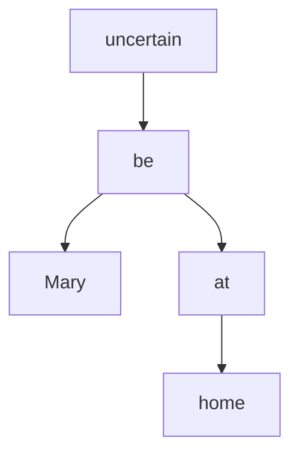
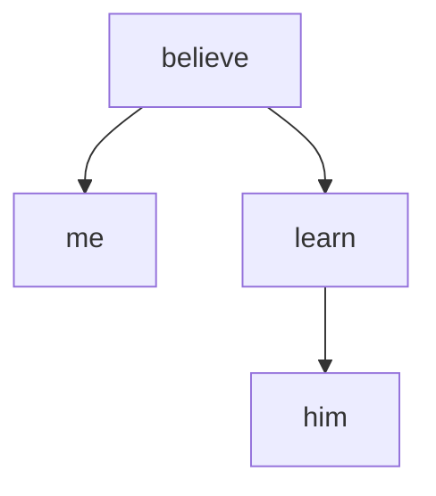
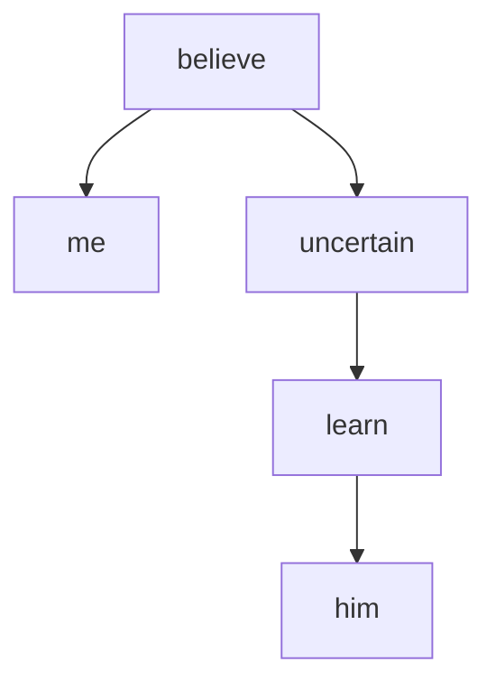

# Chapter 1: Introduction

<mark>Modality</mark> is a grammatical category of the clause, generally (but not always) marked within the verbal complex. 

Modality is concerned with the ‘status’ of ‘propositions’ that ‘describe/portray’ ‘situations’ (events, states, actions, …), as ‘reported’ by ‘utterances’.

> Modal structure sits **outside**, or **above**, event structure. 

Contents:
- 1.1. [Basic concepts](#11-basic-concepts)
  - 1.1.1. [Realis and irrealis](#111-realis-and-irrealis)
    - [English modal verbs](#english-modal-verbs)
    - [Spanish subjunctive](#spanish-subjunctive)
    - [Amele realis and irrealis suffixes](#amele-realis-and-irrealis-suffixes)
  - 1.1.2. [The notion of assertion](#112-the-notion-of-assertion)
- 1.2. [Two basic distinctions](#12-two-basic-distinctions)
  - 1.2.1. [Mood and modal systems](#121-mood-and-modal-systems)
  - 1.2.2. [Propositional and event modality](#122-propositional-and-event-modality)
- 1.3. [The classification of modality in modal systems](#13-the-classification-of-modality-in-modal-systems)
  - 1.3.1. [Epistemic and evidential](#131-epistemic-and-evidential)
  - 1.3.2. [Deontic and dynamic](#132-deontic-and-dynamic)
- 1.4. [Other types of modality](#14-other-types-of-modality)
  - 1.4.1. Presupposed
  - 1.4.2. [Negative and interrogative](#142-negative-and-interrogative)
  - 1.4.3. [Wishes, fears, etc.](#143-wishes-fears-etc)
  - 1.4.4. 

## 1.1. Basic concepts

### 1.1.1. Realis and irrealis

Modality does not refer to a characteristic of the situation reported by a clause, but rather to the status of the proposition that describes that situation. 

In recent years, modality has generally been discussed in terms of a binary opposition between:
- <mark>realis modality</mark> – the situations described by the proposition are ‘actualised’, actually occurring or having actually occurred, and ‘knowable through direct perception’. 
- <mark>irrealis modality</mark> – the situations described are ‘purely within the realm of thought, knowable only through imagination‘.

However, among languages with a grammaticalised opposition between realis and irrealis, there is considerably variation in the classification of lower-level categories (eg. commands, futures, questions, denials, reports) in terms of this opposition. 

Here are some examples of realis and irrealis from different languages—

#### English modal verbs

In **English**, a modal verb can be used to distinguish irrealis from realis, for example:
- `Mary is at home.` — a ‘categorical statement’, ie. realis
- `Mary may/must be at home.` — ‘judgments’ about propositions, ie, irrealis.

> This is an example of main clause modality. It surely implies some kind of semantic representation where the representation of ‘Mary is at home’ is embedded within the scope of a modal operator ‘possible/necessary/uncertain’ (cf. ‘It is possible that Mary is at home’):

> Note that ‘Mary is at home’ asserts a fact about the external world; ‘Mary may/must be at home’, however, asserts a fact about the contents of the speaker’s mind — what she knows and what she is uncertain about. 

[Back up to top](#)

#### Spanish subjunctive

In **Spanish**, subjunctive mood can be used to distinguish irrealis from realis in a subordinate clause, eg.
- `Creo que aprende.` ‘I believe that he is learning.’ — indicative mood marks realis
- `Dudo que aprenda.` ‘I doubt that he is learning.’ — subjunctive mood marks irrealis.

> This is an example of subordinate clause modality. The non-negated verb `creo` governs an **indicative** complement clause, because its meaning does not express significant uncertainty. On the other hand, the non-negated verb `dudo` governs a **subjunctive** complement clause, because its meaning does express significant uncertainty.
>
> However, negated `creo` seems to mainly govern a subjunctive, and negated `dudo` an indicative.

The semantic representation for non-negated `creo` might be something like:

And for non-negated `dudo`:

[Back up to top](#)

#### Amele realis and irrealis suffixes

In Amele (Papuan), the verb suffixes `-eb` and `-en` mark irrealis and realis subordinate clauses respectively, eg.
- `ho bu-busal-en age qo-in` ‘They killed the pig as it ran out.’ — realis marks remote past tense
- `ho bu-busal-eb age qo-qag-an` ‘They will kill the pig as it runs out.’ — irrealis marks future tense.

> There might be some kind of grammatical ‘agreement’ going on here. The past tense main clause suffix `-in` selects a modifier headed by the realis suffix `-en`; and the future tense main clause suffix `-an` selects one headed by the irrealis suffix `-eb`.

[Back up to top](#)

### 1.1.2. The notion of assertion

Another characterisation of the difference between realis and irrealis modality is that:
- realis propositions are <mark>asserted</mark>
- irrealis propositions are not asserted.

The following Spanish subordinate clauses show that there are three reasons why a proposition may be ‘unworthy of assertion’, and hence contain a subjunctive verb:
- `Dudo que sea buena idea.` ‘I doubt that it be a good idea.’ – the speaker has doubts about the proposition’s veracity
- `Necesito que me devuelvas ese libro.` ‘I need that you return me that book.’ – the proposition is unrealised
- `Me alegra que sepas la verdad.` ‘It pleases me that you know the truth.’ – the proposition is factual, but **presupposed** ie. known to be true by both speaker and hearer, and hence lacking information value.

> Questions: Does `necesito` always govern the subjunctive? Even when it is negated? Does the same go for `alegra`?\]

[Back up to top](#)

## 1.2. Two basic distinctions

### 1.2.1. Mood and modal systems

Languages express modality in two main ways:
- mood
- modal systems

Some languages use both devices (eg. German, Central Pomo), but in most languages, one is much more salient than the other.

#### Mood

Mood is generally a binary category expressed in verb inflections. 

In a mood language, all/most clauses are generally either:
- realis / indicative
- irrealis / subjunctive.

Indicative / subjunctive is characteristic of European languages, exemplified by the Spanish examples above. 

Realis / irrealis is characteristic of Native American languages and in the languages of Papua New Guinea, exemplified by the Amele examples above. 

Some distributional differences between indicative/subjunctive and realis/irrealis:
- Subjunctive is usually restricted to subordinate clauses.
- Irrealis often co-occurs with other grammatical markers.
- Hence both are often notionally redundant, but in different ways.
- Realis / irrealis does not usually co-occur with a tense system. Realis is past or present, future is irrealis. 

#### Modal systems

Modal systems are generally non-binary — ‘different kinds of modality are distinguished within a single system of commuting terms’.

Some examples involving English ‘epistemic’ modal verbs:
- `Kate may be at home now.` – a possible conclusion, ie. <mark>speculative</mark> modality
- `Kate must be at home now.` – the only possible conclusion. ie. <mark>deductive</mark> modality
- `Kate will be at home now.` – a reasonable conclusion, ie. <mark>assumptive</mark> modality

Some other examples from the evidential system of Central Pomo:

- `čhéemul` ‘it rained’
- `čhéemul-?ma` ‘it rained — this is an established fact, general knowledge’
- `čhéemul-ya` ‘it rained — I saw it (first hand)’
- `čhéemul-nme` ‘it rained — I heard it (first hand)’
- `čhéemul-?do` ‘it rained — someone told me’ 
- `čhéemul-?ka` ‘it rained — I inferred this from the fact that everything is wet’

English modal verbs can be understood as irrealis, in contrast to the realis declarative:
- `Kate is at home now.`

[Back up to top](#)

### 1.2.2. Propositional and event modality

There is a core distinction between:
- <mark>propositional modality</mark> — concerned with the speaker’s judgment of a proposition, her attitude towards its truth value or factual status
- <mark>event modality</mark> — concerned with the speaker’s attitude towards a potential future event, an event that is not yet actualised. 

The following examples exhibit one kind of **propositional** modality — <mark>epistemic modality</mark>:

- `Kate may be at home now.` (ie. speculative modality)
- `Kate must be at home now.` (ie. deductive modality)

Propositional modality can be paraphrased using `that`:

- `It is possible that Kate is at home now.`
- `It is necessarily the case that Kate is at home now,`

Note that another kind of propositional modality is <mark>evidential modality</mark>. 

The following examples exhibit one kind of **event modality** — <mark>deontic modality</mark>:

- `Kate may come in now.`
- `Kate must come in now.`

Event modality can be paraphrased using `for`:

- `It is possible for Kate to come in now.`
- `It is necessary for Kate to come in now.`

Note that another kind of event modality is <mark>dynamic modality</mark>. 

\[MM: event modality is directive, granting permission or asserting obligation. Think about aspect and tense.\]

[Back up to top](#)

## 1.3. The classification of modality in modal systems

### 1.3.1. Epistemic and evidential

The two main types of propositional modality are:
- epistemic modality — speakers express their judgments about the factual status of the proposition
- evidential modality — speakers indicate the evidence they have for a proposition’s factual status.

The English modal verb examples in §1.2.1. show three subtypes of epistemic modality:
- speculative modality — `Kate may be at home now.`
- deductive modality — `Kate must be at home now.`
- assumptive modality — `Kate will be at home now.`

The Central Pomo examples in §1.2.1. show five subtypes of evidential modality:
- <mark>reported modality: general knowledge</mark>
- <mark>visual modality</mark> — first-hand personal experience, usually visual
- <mark>auditory modality</mark> — auditory evidence
- <mark>reported modality: hearsay</mark>
- inference — same as deductive propositional modality.

Note that inferential/deductive modality involves a judgment based on evidence, conveying the speaker’s confidence in the truth of the proposition, based on a deduction from facts known to him (which may or may not be specified), eg. *Kate must be at home (because she is not in her office)*.

Note also that evidentials may occur within a predominantly epistemic system. Examples from German:
- `Er soll steinreich sein.` ‘He is said to be extremely rich.’
- `Er will eine Mosquito abgeschossen haben.` ‘He claims to have shot down a Mosquito.’

There are two main types of evidential modality, each of which subsumes two or three subtypes:
- <mark>sensory modality</mark>
- <mark>reported modality</mark>.

[Back up to top](#)

### 1.3.2. Deontic and dynamic

There are two main types of event modality:
- deontic modality — the conditioning factors are **external** to the relevant individual, relating to obligation or permission emanating from an external source, eg. the law, the speaker
- dynamic modality — the conditioning factors are **internal**, ie. ability or willingness.

Examples of deontic modality:
- `John may/can come in now.` — <mark>permissive modality</mark>
- `John must come in now.` — <mark>obligative modality</mark>

Examples of dynamic modality:
- `John can speak French.` — <mark>abilitative modality</mark>
- `John will do it for you.` — <mark>volitive modality</mark>

Note that deontic modal clauses are often **directives**, attempts to get others to do things.

Note also that ability is not just a matter of the subject’s physical or mental powers, but can include other circumstances that immediately affect them, as in:
- `He can go now.` — permissive
- `He can run a mile in five minutes.` — abilitative (physical power)
- `He can escape (because the door is not locked).` — abilitative (outside circumstances).

Note also the following **commissive** modality:
- `You shall have it tomorrow.` — I commit myself to doing this. A kind of deontic modality?

[Back up to top](#)

## 1.4. Other types of modality

### 1.4.1. Presupposed

[Back up to top](#)

### 1.4.2. Negative and interrogative

In some languages, negatives and interrogatives occur within modal systems or are marked with irrealis mood.

For example the epistemic modal system in Imbabura Quechua includes a marker for negation and interrogation:
- `kan-paj ushi-wan Agatu-pi-mi` ‘I met your daughter in Ageto.’ — `-mi` marks first-hand information
- `kaya-shi kan-paj churi shamu-nga` ‘I suppose your son will come tomorrow.’ — `-shi` marks a conjecture
- `Juzi-ka kitu-man chaya-shka-chá’ ‘Perhaps José has arrived in Quito.’ — `-chá` marks doubt
- `mayistru-chu ka-ngui` ‘Are you a teacher?’ — `-chu` marks a yes/no question
- `ñyuka-ka mana chay llama-ta shuwa-shka-ni-chu` ‘I didn’t steal that sheep.’ — `-chu` marks negation

Similarly, negatives and interrogatives are both marked with irrealis `-yi` in the Caddo mood system:
- `kúy-t’ayi-bahw` ‘I don’t see him.’
- `sah?yi-bahw-nah` ‘Have you seen him?’

In European languages:
- Reported questions are expressed with the subjunctive in Latin.
- In Spanish and Italian, a negated verb of saying usually governs the subjunctive.

[Back up to top](#)

### 1.4.3. Wishes, fears, etc.

Wishes and fears are partly deontic (expressing attitudes towards propositions that relate to unrealised events), partly epistemic (expressing attitudes towards propositions whose factual status is not known).

In Latin and Ancient Greek, wishes and fears are expressed by the subjunctive not only in subordinate clauses, but also in main clauses too:
- `modo valeres` ‘If only you were well!’ — `valeres` ‘you are well’ is a subjunctive verb
- `mé: soús diaphthéire:i gámous` ‘(I’m afraid) she may ruin your marriage.’ — `diaphthéire:i` ‘she ruins’ is a subjunctive verb.

In Fula (West African), wishes can be marked as subjunctive:
- `njuutaa balde` ‘May you live long!’ — `njuutaa` is a subjunctive verb meaning ‘you are long’.

Expressions of wanting, desire and preference relate to unrealised events, and may be marked as irrealis, especially in subordinate clauses, as in Spanish:
- `quiero que estudias más` ‘I want that you study more.’

[Back up to top](#)

### 1.4.4. Past tense as modal

In some languages, past tense forms can be used to express unreality, tentativeness, potentiality. 

In English, the past tense modal verb forms — `would`, `could`, `might` — can be used to express greater tentativeness:
- `He’ll be there now.` / `He’d be there now.`
- `He may be there now.` / `He might be there now.`
- `He can’t be there now.` / `He couldn’t be there now.`

Also in English, like in some other languages, a distinction is made between ‘real’ and ‘unreal’ conditionals, with the latter marked by past tense:
- `If the children are here, John will be happy.` / `If the children were here, John would be happy.` — the second sentence has the clear implication that the children are not here
- `If Mary comes, John will stay.` / `If Mary came, John would stay.` — the second sentence implies that it is unlikely that Mary will come.

[Back up to top](#)

### 1.4.5. Complex systems

Modal systems found in languages are generally far from being orderly and simple.

Firstly, two apparently different systems may use the same set of markers. 

For example, English uses the same modal verbs for both epistemic modality and deontic/dynamic modality:
- `He can’t be in his office now.` — epistemic
- `He can come in now.` — deontic, permission
- `He can run a mile in four minutes.` — dynamic, ability

Secondly, notionally identical modal categories may be treated as members of one system in one language, and of another system in another language. As discussed above, Deductive modality is part of a judgment system in English, but is part of an evidential system in Central Pomo.

Thirdly, a single formal system often contains forms that belong to two different modal systems. For examples, German modal verbs function as both epistemic and deontic, but also as evidentials (cf. ‘sollen’ and ‘wollen’).

Fourthly, there may not be a simple one-to-one relation between the terms of a formal system and some of the typologically relevant modal features.

For example, in Lega (Bantu), there are three modal particles:
- reported `bazongo`
- speculative 
- sensory `ampó`

Lega (Bantu):
- `nkumgwágá (bóno), ámbo bazongo bé kulyágá merende` ‘I hear that Whites eat frogs (though I find that unlikely).’
- `ampó mbulá zésaloka` ‘It is already raining. (I can see it.)’
- `ampó ékukúrá momponge` ‘She is assuredly pounding rice. (I can hear it.)
- `ampó Kisangá éndile kw isoko; kikápu kyǎgé také gáno` ‘Kisanga surely went to the market; her basket is not here.’
- `ampó Moké ákorwa` ‘Moke is tired. (He told me.)’

Ngiyambaa:

[Back up to top](#)

## 1.5. Typology

[Back up to top](#)

----

Back up to: [Palmer (2001)](index.md) | [Verbs](../index.md)
